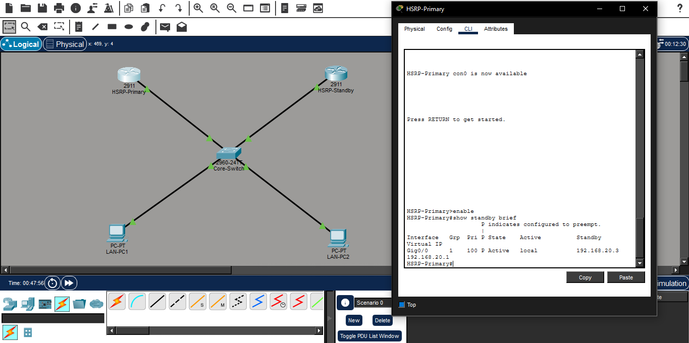
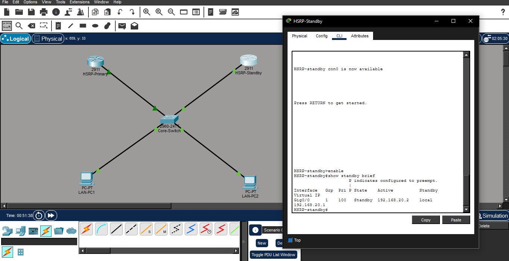

# High-Availability Gateway Redundancy Infrastructure via Hot Standby Router Protocol (HSRP)

## 📌 Project Overview
This project demonstrates the design, deployment, and validation of a high-availability default gateway infrastructure using Cisco's proprietary Hot Standby Router Protocol (HSRPv1). The architecture addresses single-point-of-failure vulnerabilities at the corporate network edge by configuring redundant layer 3 routing paths to act as a singular resilient gateway layer.

By establishing active/standby failover mechanisms, local endpoints remain completely insulated from upstream network hardware disruptions. Traffic automatically shifts between parallel routing nodes within seconds of a critical topology failure, sustaining continuous corporate data-plane availability.

---

## ⚡ Core Resiliency Features
* **First-Hop Redundancy Configuration:** Integrated a multi-router cluster sharing an elastic Virtual IP default gateway to shield end devices from hardware failure states.
* **Deterministic Gateway Selection:** Set manual HSRP priorities (`110` vs standard `100`) to guarantee predictable symmetric traffic flows through the premium active forwarding pathway.
* **State Machine Preemption:** Enabled preemption engines on the active perimeter path, allowing a recovered high-capacity primary router to seamlessly recapture active routing status.
* **Failover Automation:** Deployed background hello/hold timer configurations to automate cluster detection changes and provide continuous uptime without administrative intervention.

---

## 🗺️ Network Redundancy Design & Topology Schema

### 💻 Local LAN Endpoints
* **LAN-PC1 Static Assignment:** `192.168.20.10/24` | Default Gateway: `192.168.20.1`
* **LAN-PC2 Static Assignment:** `192.168.20.20/24` | Default Gateway: `192.168.20.1`
* *Note:* Endpoints exclusively address the Virtual Gateway IP, keeping local configurations independent of physical hardware states.

### 🔀 Active Infrastructure Forwarding Node
* **Host Target:** `HSRP-Primary` | Physical Port IP: `192.168.20.2/24`
* **HSRP Parameter Profile:** Standby Group `1` | Priority `110` | Preempt enabled.

### ⏳ Resilient Backup Forwarding Node
* **Host Target:** `HSRP-Standby` | Physical Port IP: `192.168.20.3/24`
* **HSRP Parameter Profile:** Standby Group `1` | Priority `100` (Default standard backup).

---

## 📑 Implementation & Verification Logs

### 1. Functional Gateway Redundancy Topology Map

*Caption:* Converged high-availability baseline infrastructure tracking active link states running from local endpoints to parallel hardware forwarding nodes.

### 2. Primary Gateway State Validation (Control-Plane Capture)

*Caption:* Diagnostic telemetry output from the master path interface confirming state status as `Active`, acknowledging its backup tracking node at `192.168.20.3`.

### 3. Standby Gateway Redundancy Validation

*Caption:* Diagnostic telemetry output from the backup path interface validating state status as `Standby` and tracking `192.168.20.2` as the live operational forwarder.

---

## 🛠️ Executed High-Availability IOS Configurations
The following high-availability parameter profiles were implemented across the enterprise routing layer:

```text
HSRP-Primary# show running-config interface GigabitEthernet0/0
interface GigabitEthernet0/0
ip address 192.168.20.2 255.255.255.0
standby 1 ip 192.168.20.1
standby 1 priority 110
standby 1 preempt

HSRP-Standby# show running-config interface GigabitEthernet0/0
interface GigabitEthernet0/0
ip address 192.168.20.3 255.255.255.0
standby 1 ip 192.168.20.1
```

