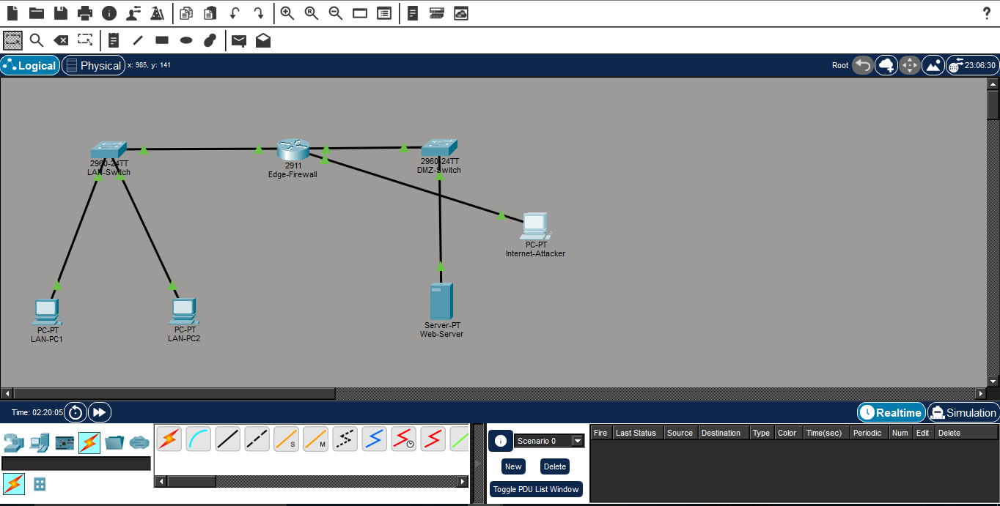
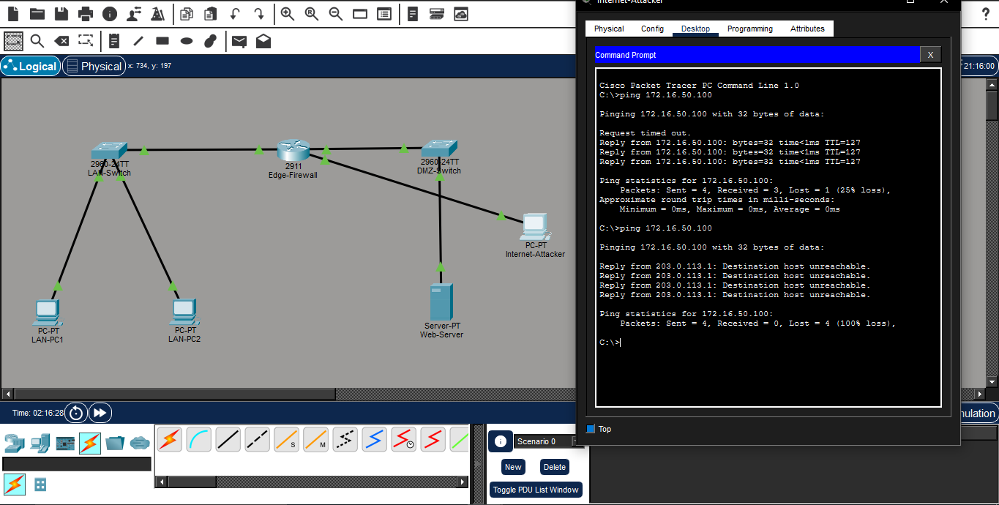
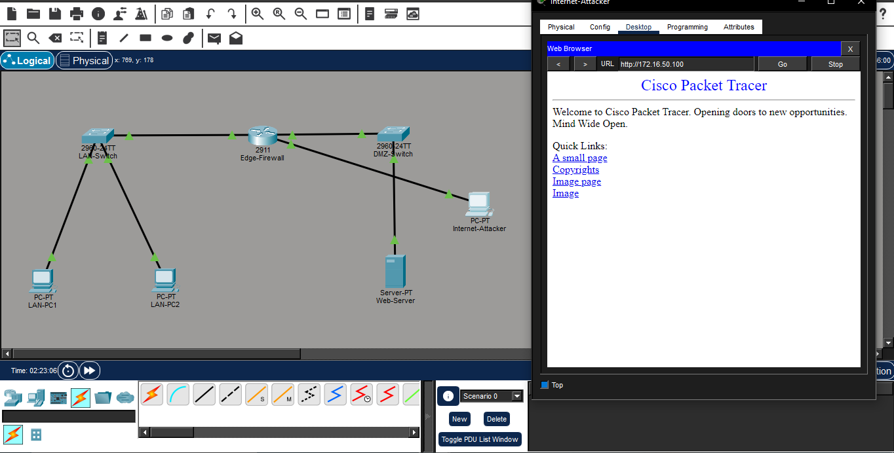

# Perimeter Firewall Deployment & DMZ Security Infrastructure via Cisco Extended ACLs

# 📌 Project Overview
This project demonstrates the engineering and implementation of a hardened edge perimeter security matrix using a Cisco layer 3 routing platform functioning as an Enterprise Firewall. The architecture isolates a trusted internal corporate LAN, segments a public-facing Demilitarized Zone (DMZ) hosting an enterprise web application server, and defends core infrastructure boundaries against unauthorized traffic originating from the untrusted public Internet.

Security access policies were designed, deployed, and validated inside Cisco Packet Tracer using **Extended Named Access Control Lists (ACLs)** to inspect transport layer headers and enforce traffic restriction parameters based on network protocols, host destinations, and application port constraints.

# ⚡ Core Security Features
**Perimeter Access Control:** Engineered an Extended Access Control List bound to the external untrusted interface to intercept, analyze, and filter inbound IP packets.
**Protocol-Level Hardening:** Configured precise L4 TCP port parameters to isolate public service vectors, allowing HTTP (TCP Port 80) and HTTPS (TCP Port 443) traffic directly to designated assets while discarding unstructured transport requests.
* **Reconnaissance Suppression:** Explicitly dropped ICMP Echo Requests (Pings) to mask internal topologies and eliminate vulnerabilities to network mapping scans or automated host discovery probes.
**DMZ Network Segmentation:** Isolated public servers into a discrete subnet (DMZ) to ensure that in the event of an external application breach, lateral threat movement toward the internal private LAN remains completely contained.

# 🗺️ Network Topology Design & Hardening Matrix

## 🔒 Inside Trusted LAN Zone
**Host Addresses:** `192.168.10.10` (LAN-PC1) | `192.168.10.20` (LAN-PC2)
**Default Gateway:** `192.168.10.1` Bound to interface `Gi0/0`
**Trust Profile:** Deep internal visibility; permissioned to perform outbound requests across all system areas.

## 🛡️ Secure Demilitarized Zone (DMZ Server Farm)
* **Production Host:** `172.16.50.100` (Web-Server running active HTTP/HTTPS service endpoints)
* **Default Gateway:** `172.16.50.1` Bound to interface `Gi0/1`
* **Trust Profile:** Restricted ingress; isolated boundary limits to prevent internal data extraction.

## 🌐 Outside Untrusted Internet
**Untrusted Endpoint:** `203.0.113.50` (Simulated Internet Host / Network Discovery Scanner)
**Default Gateway:** `203.0.113.1` Bound to firewall perimeter interface `Gi0/2`

# 📑 Implementation & Security Verification Logs

## 1. Functional Perimeter Firewall Topology Map

*Caption:* Architectural layout showing link statuses across the Inside Trusted LAN, DMZ, and untrusted network zones controlled by the perimeter gateway device.

## 2. Reconnaissance Suppression Log (Control-Plane Traffic Block)

*Caption:* Hardened edge validation log. The perimeter firewall drops the external host discovery sweep, resulting in a explicit `Destination host unreachable` indicator from gateway interface `203.0.113.1`.

## 3. Application-Layer Ingress Verification (HTTP Session Validation)

*Caption:* Successful validation of public application plane entry. The external user successfully requests web resources from `172.16.50.100` over authorized port 80, proving traffic classification accuracy.

# 🛠️ Executed Perimeter Hardening CLI Configurations
The following security matrices were compiled and written into the security appliance operating system:
```text
Edge-Firewall# show running-config | section access-list
ip access-list extended PERIMETER_FIREWALL
permit tcp any host 172.16.50.100 eq 80
permit tcp any host 172.16.50.100 eq 443
deny icmp any any
deny ip any any

Edge-Firewall# show ip interface brief
Interface IP-Address OK? Method Status Protocol
GigabitEthernet0/0 192.168.10.1 YES manual up up
GigabitEthernet0/1 172.16.50.1 YES manual up up
GigabitEthernet0/2 203.0.113.1 YES manual up up
```
